# Architecture

ClearCare v2 is still a **zero-runtime-dependency Node.js app**: one `server.js`, static files in `public/`, and vendored pdf.js. Everything new is an **extension** under `public/ext/` (isomorphic: runs in both browser and Node) or `lib/ext/` (server only). The original modules are untouched and are still used.

```mermaid
flowchart LR
  subgraph Browser["Browser (patient device)"]
    UP[PDF upload / sample] --> ORIG["ORIGINAL app.js<br/>pdf-reader.js + structured-extract.js"]
    ORIG -- "clearcare:document event (bridge)" --> ING
    ING["DocumentIngestionProvider<br/>pdf.js text layer → layout (columns, tables, rotation)<br/>fallback: original pdf-reader.js"] --> ENG
    ENG["ClinicalExtractionProvider<br/>engine.js: meds (status/dose/taper/negation), visits, tasks, warnings<br/>+ provenance (page, lines, method, confidence)"] --> SAFE
    SAFE["ClinicalSafetyValidator<br/>clarity + reasons → schedulable?"] --> REN
    REN["ExplanationStrategy (rules)<br/>render.js EN/ES/HI × simple/detailed/steps"] --> UI
    SAFE --> CAL["CalendarBriefingStrategy<br/>buildDay / buildBriefing"] --> UI
    UI["Today view (ext/main.js)"] --> TTS["SpeechSynthesisProvider<br/>Web Speech + speech/normalize.js verify"]
    UI --> QA["qa/intent.js<br/>EN/ES/HI + Hinglish intents, retrieval ≤3"]
  end
  subgraph Server["Local server 127.0.0.1 (same computer)"]
    R["lib/ext/routes.js"] --> EX["explain-v2.js"] --> GEM
    R --> ASK["ask.js"] --> GEM
    GEM["Gemini GenerateContent provider<br/>gemini-3.8-flash by default<br/>timeout · bounded retry · telemetry"] --> VER["fidelity.js verifier<br/>(same code as browser)"]
    R --> OCR["OCRProvider: pdftoppm + tesseract (optional)"]
    LEG["ORIGINAL /api/explain → gemini-explainer.js"] --> DEC["verifyLegacyExplanation decorator"]
  end
  UI -- "one instruction" --> R
  QA -- "question + ≤3 excerpts" --> R
```



## Patient journey (swimlane)

```mermaid
sequenceDiagram
  participant P as Patient
  participant B as Browser (ClearCare)
  participant S as Local server
  participant A as Google Gemini API
  P->>B: Upload discharge PDF
  B->>B: pdf.js text + layout → engine → safety (no network)
  B-->>P: Today: briefing text + "Hear my day" (+ autoplay only with consent)
  P->>B: Explain with Gemini (one card)
  B->>S: { instruction, language, mode }
  S->>S: re-parse; unclear → stop (no AI call)
  S->>A: system rules + <instruction> only
  A-->>S: JSON {explanation, steps}
  S->>S: schema check → fidelity check (numbers, units, names, negation, frequency, severity, language)
  S-->>B: verified text OR withheld (original words + clarification)
  P->>B: "Follow-up appointment kab hai?"
  B->>B: intent → answer from plan (rules) or ≤3 excerpts → /api/v2/ask (verified)
```

## Module map

| Interface (directive name) | Implementation |
|---|---|
| DocumentIngestionProvider / PDFTextProvider | `public/ext/document/browser-provider.js`, `lib/ext/document-node.js` (pdf.js, then the original parser as fallback) |
| LayoutAnalysisProvider | `public/ext/document/layout.js`: line grouping, gutter detection (1 gutter = columns, ≥ 2 = table), sideways-text reading frame |
| DocumentValidationService | `validatePdfBytes` (empty, not a PDF, 12 MB limit, encryption hint), pdf.js `PasswordException`, 50-page cap |
| OCRProvider | `ocrPdfInNode` (local `pdftoppm` + `tesseract` eng/hin/spa if installed; temp files deleted) |
| SourceEvidenceMapper | `engine.js` `provenance { text, page, lines, method, confidence, statements[] }` |
| ClinicalExtractionProvider | `public/ext/clinical/engine.js` + `vocab.js` |
| ClinicalSafetyValidator | `engine.js` reasons and clarity, which gate `schedulable` |
| StructuredOutputValidator | `lib/ext/gemini-provider.js#parseJsonObject` |
| SourceGroundingValidator / AIResponseVerifier | `public/ext/clinical/fidelity.js#verifyExplanation` |
| GeminiInferenceProvider / InferenceTelemetry / InferenceFallbackStrategy | `lib/ext/gemini-provider.js` (fallback = labelled rule-based rendering; never a fabricated AI text) |
| ExplanationProvider / ExplanationStrategy | `lib/ext/explain-v2.js` (Gemini), `public/ext/clinical/render.js` (rules) |
| LanguageProvider / LanguageDetectionProvider | `public/ext/i18n.js`, `qa/intent.js#detectLanguage` |
| SpeechSynthesisProvider / SpeechRecognitionProvider / SpeechPlaybackController | `public/ext/ui/voice.js` |
| SpeechVerificationService | `public/ext/speech/normalize.js` |
| CalendarBriefingStrategy | `public/ext/calendar/briefing.js` |
| ReminderDeliveryProvider | `.ics` (`calendar/ics.js`) and in-app timer (page open only) |
| PatientPreferenceProvider / CarePlanRepository | `main.js` localStorage wrapper (opt-in plan persistence), export and delete |
| ComprehensionCheckProvider | Card controls: I understand / Explain again / Speak more slowly / Show original / I need clarification |

## Which components use Gemini

| Uses Gemini inference | Does **not** use Gemini (deterministic or browser) |
|---|---|
| Original `/api/explain` (unchanged) · `/api/v2/explain` (3 modes) · `/api/v2/ask` (open questions only) | PDF reading (pdf.js) · OCR (tesseract) · extraction and safety rules · rule-based rendering · briefing · speech (Web Speech API) · intents |
